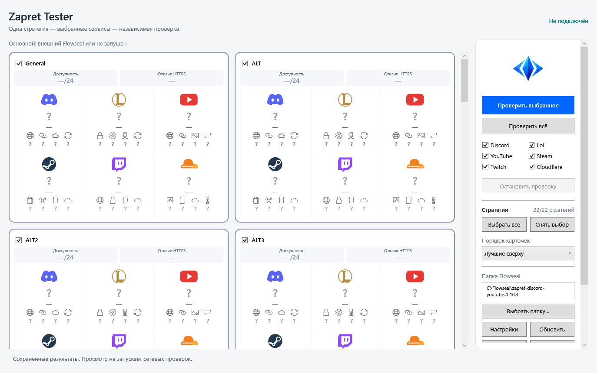

# Zapret Tester

Разработчик — **Maverick Vision Productions**. Свободное ПО с открытым исходным кодом по [лицензии MIT](LICENSE). [Репозиторий проекта](https://github.com/MaverickVision/ZapretTester).

**Сравните стратегии Flowseal для Discord, League of Legends, YouTube, Steam, Twitch и Cloudflare на одной панели.**

Приложение для Windows 11 x64 проверяет HTTPS-службы через каждую выбранную стратегию и показывает **доступность до 24/24**, **отклик HTTPS до 10 баллов** и подробности ошибок. Основной вариант включается только по вашему выбору.

**[Скачать последнюю сборку 1.1.0-preview.1 для Windows x64](https://github.com/MaverickVision/ZapretTester/releases/download/v1.1.0-preview.1/ZapretTester-win-x64.zip)** · [Страница выпуска](https://github.com/MaverickVision/ZapretTester/releases/tag/v1.1.0-preview.1) · [Полная инструкция](docs/USER_GUIDE.ru.md) · [Сообщить об ошибке](https://github.com/MaverickVision/ZapretTester/issues)

**Предварительный выпуск от 22 октября 2026.** Сборка, 166 автоматических тестов и проверка настоящего WPF-интерфейса пройдены. Полная живая сетевая приёмка новой общей очереди ещё не завершена; этот выпуск отмечен как pre-release. [Статус проверок и ограничения](IMPLEMENTATION_STATUS.md).



## Быстрый старт

В готовом архиве всего три элемента верхнего уровня: **ZapretTester.exe** — запуск, **ИНСТРУКЦИЯ.html** — руководство и **app** — служебные файлы. Переносите папку целиком; содержимое `app` вручную запускать не нужно. Кнопка **«О программе»** показывает разработчика, версию, лицензию и ссылку на GitHub.

1. В **Releases → Assets** скачайте `ZapretTester-win-x64.zip` и распакуйте весь архив. **Source code** для запуска не нужен. Готовая сборка уже содержит .NET.
2. Отдельно скачайте совместимую [Flowseal 1.10.3](https://github.com/Flowseal/zapret-discord-youtube/releases/tag/1.10.3) или [1.10.2](https://github.com/Flowseal/zapret-discord-youtube/releases/tag/1.10.2).
3. Запустите `ZapretTester.exe` и выберите корневую папку Flowseal с `general*.bat`, `bin` и `lists`.
4. Если Flowseal уже работает как служба, используйте **«Подготовить Flowseal к проверке»** в меню основного процесса. Подтвердите сохранение её состояния и переход под управление тестера.
5. Отметьте нужные сервисы и стратегии, нажмите **«Проверить выбранное»**. Подтвердите системный запрос администратора для Helper.
6. Сравните карточки. Нажмите название стратегии, изучите подробности справа и выберите **«Сделать основным»** для проверенного варианта.

Код и командная строка не нужны. В переносимом архиве есть **ИНСТРУКЦИЯ.html**, которая открывается без интернета.

## Где находится League of Legends

Обычно папка игры называется **`League of Legends`** и расположена в **`C:\Riot Games\League of Legends`**. На другом диске это может быть **`D:\Riot Games\League of Legends`**.

Откройте Проводник (**Win + E**) и вставьте путь в адресную строку. В правильной папке находятся **`LeagueClient.exe`** и **`system.yaml`**, обычно также `Config` и `Game`. Выберите её через **Настройки → Папка League of Legends → …**.

Если папка не найдена, нажмите правой кнопкой по ярлыку игры → **Расположение файла** или найдите `LeagueClient.exe` в **Этот компьютер**. Ярлык может вести в `Riot Client`: это лаунчер, его папка не подходит. Нужна папка самой игры, не вложенная `Game` и не отдельный EXE.

[Подробный поиск, включая Диспетчер задач](docs/USER_GUIDE.ru.md#league). Если LoL не установлена, снимите её галочку. Остальные сервисы не требуют установленного клиента или аккаунта.

Карточки автоматически распределяются по доступной ширине, без пустой полосы между сеткой и панелью управления. Все команды находятся в правой панели. Вверху во время подготовки и проверки воспроизводится зацикленная анимация, затем идут **«Проверить выбранное»** и **«Проверить всё»**, под ними — галочки сервисов. Остальные команды расположены ниже; панель прокручивается независимо от карточек. Кнопка **FAQ** над «О программе» кратко объясняет показатели и настройки. Кристаллы видны постоянно: в ожидании это неподвижный кадр, во время проверки — анимация. Размер и положение одинаковы. Анимация хранится локально, сохраняет прозрачность и останавливается в ожидании и при сворачивании окна.

**«Проверить всё»** проверяет все найденные стратегии для отмеченных сервисов, сохраняя выбор карточек. При нехватке портов приложение объяснит, как расширить пул. Просмотр и обновление сводки не запускают сетевые проверки.

При конфликте с другим Zapret появится русское объяснение с PID и кнопкой **«Подготовить Flowseal к проверке»**. Она открывает существующую процедуру подтверждения; неизвестные программы автоматически не останавливаются.

## Одна панель, один проверяемый вариант

- Галочки **Discord / LoL / YouTube / Steam / Twitch / Cloudflare** выбирают состав проверки и секции карточек.
- У каждой стратегии своя галочка; доступны выбор всех, остановка, обновление сохранённых данных, настройки, диагностика и журнал.
- На карточке до трёх сервисов в ряд; четыре–шесть размещаются в двух рядах. Название открывает подробности справа, а галочка выбирает стратегию для следующего запуска.
- Все выбранные сервисы проверяются через **один процесс и один общий вариант стратегии**. Исходные группы сохраняются. Для выбранных LoL, Steam, Twitch и Cloudflare добавляется узкая HTTPS-группа их хостов; Discord и YouTube сохраняют обработку исходными группами.
- Изменение набора сервисов или региона выбирает другой вариант. Результаты разных вариантов и серий не смешиваются. Неполная конфигурация выбранного сервиса блокирует общий вариант.
- Галочки можно менять во время серии: текущий план остаётся прежним. Сам просмотр панели не запускает Helper, `winws` или сетевые проверки.
- **«Сделать основным»** запускает проверенный общий вариант. Перед переключением отпечаток ресурсов проверяется повторно; при изменениях нужна новая проверка.

Старые независимые результаты сохраняются в истории с резервной копией, но новый общий вариант нужно проверить заново. Прежний основной процесс при обновлении не превращается автоматически в вариант с новыми сервисами.

## Доступность, отклик и цвета

**Доступность X/Y** — число успешных HTTPS-проверок: четыре адреса на сервис, максимум **24/24**. HTTP 429/5xx — предупреждения сервера, успехами не считаются.

| Обводка | Доля доступных адресов |
|---|---|
| Зелёная | От 80% |
| Янтарная | От 50% до менее 80% |
| Красная | Менее 50% |
| Серая | Нет полного актуального достоверного результата |

**Отклик HTTPS /10** — отдельная оценка: среднее медиан успешных запросов выбранных сервисов преобразуется по формуле `(1000 − мс) / 90`, ограниченной 0–10. До 100 мс — 10; 200 мс — 8,9; 500 мс — 5,6; от 1000 мс — 0. Если у сервиса нет успешных адресов, общей оценки отклика нет.

**Миллисекунды — не ICMP-пинг:** они включают TCP, TLS и ожидание HTTP-заголовков, без DNS. Поэтому показания могут быть выше пинга другого инструмента. Это не скорость загрузки или задержка в матче.

**Лучшие сверху** сортирует по доступности, затем отклику и естественному названию. Карточки не скрываются. Во время серии готовые стратегии обновляются сразу: видны доступность, миллисекунды и предварительный балл отклика. Они помечены «Предварительно», рамки и значки остаются серыми до подтверждения изоляции всей серии. Автоматическая сортировка заморожена. После отмены или конфликта они не становятся зелёными.

## Границы проверки

| Сервис | Четыре адреса | Не проверяется |
|---|---|---|
| Discord | Сайт, Gateway HTTPS, CDN, Update | Вход, WebSocket и голос |
| League of Legends | Авторизация Riot, конфигурация, платформа региона, CDN | Вход, матч, игровой ping, голос, Vanguard |
| YouTube | Сайт, короткие ссылки, изображения, перенаправление видео | Воспроизведение и скорость видео |
| Steam | Магазин, сообщество, API HTTPS, CDN | Вход, скачивание игр и игровые серверы |
| Twitch | Сайт, авторизация HTTPS, API HTTPS, CDN | Вход, чат, просмотр и ведение трансляций |
| Cloudflare | Диагностика, документация, CDNJS, тестовый edge | DNS 1.1.1.1, WARP, скорость и все сайты за Cloudflare |

IPv4, HTTP/1.1, штатная проверка TLS, без proxy и автоматических редиректов. Обычно HEAD; сайт Twitch использует GET до заголовков без чтения тела, потому что HEAD возвращает 405. [Все адреса и допустимые HTTP-коды](docs/USER_GUIDE.ru.md#checks).

## Скорость и настройки

По умолчанию — **4 тестовых процесса**, до двух запросов внутри каждого, **2 попытки**, **5 секунд на попытку**. В настройках доступны 1–8 процессов, 1–5 попыток и 1–60 секунд. Тайм-аут включает DNS и HTTP; показатель отклика исключает DNS. Сохранённые пользовательские значения не заменяются.

Оптимизация убирает повторную подготовку, хеширование общих ресурсов и частые промежуточные записи. Для 22 стратегий требуется до **22 тестовых запусков и 22 экспортов фильтра** независимо от количества выбранных сервисов. Методика сетевой проверки не упрощается.

Полная серия шести сервисов требует **1056 уникальных портов**. Новая установка использует 41000–42999. Старый или пользовательский диапазон сохраняется; при нехватке приложение предлагает расширение. Если основной процесс работает, его перезапуск для нового исключения портов подтверждается отдельно и предусматривает откат.

Фактическое ускорение зависит от сети, ответов и тайм-аутов. Больше параллельность не гарантирует меньшего времени и может повлиять на отклик или ограничения серверов. [Методика и состояние замеров](docs/PERFORMANCE-1.1.0.md).

## Совместимость и сохранность

- Windows 11 x64; другие системы не проверены.
- Исследованы 22 стратегии Flowseal 1.10.2 и 1.10.3, включая новый формат GameFilter 1.10.3.
- У исследованных сборок совпадают бинарники; их SHA-256 закреплены в `isolation-certificate.json`. Другой движок требует отдельной проверки изоляции. Неизвестные BAT-конструкции отклоняются; поддержка всех будущих версий не обещается.
- Для LoL адреса и регион читаются из установленной игры. Токены не используются.
- GUI работает без повышения прав; сетевой Helper требует UAC. Неизвестный обработчик WinDivert блокирует запуск или отменяет серию.
- BAT, списки, fake-файлы Flowseal и файлы Riot не изменяются; используются отдельные защищённые снимки.
- При переходе сохраняются конфигурация и состояние службы `zapret`; при ошибке предусмотрен откат. Меню **«Восстановить Flowseal»** возвращает исходную службу.
- Основной процесс по умолчанию остаётся после закрытия окна. После перезагрузки откройте приложение и выберите **«Управление основным → Запустить сохранённый»**. Просмотр панели сам не запускает Helper.

Настройки, результаты и журнал — в `%LOCALAPPDATA%\ZapretTester`; защищённые снимки и резервная конфигурация службы — в `%PROGRAMDATA%\ZapretTester`. Не публикуйте `session.json` и всю папку данных в отчёте об ошибке.

[Устранение проблем](docs/USER_GUIDE.ru.md#troubleshooting) · [Приёмка Flowseal 1.10.3](docs/COMPATIBILITY-1.10.3.md)

## Для разработчиков

C# / .NET 10 / WPF. Для разработки нужен .NET 10 SDK на Windows; готовый архив самодостаточен.

```powershell
dotnet build ZapretTester.sln -c Release
dotnet test ZapretTester.sln -c Release
.\scripts\Publish.ps1
```

Исходники разделены на Core (модели, адаптация, очередь, результаты), Windows (процессы и WinDivert), Helper (привилегированные операции), App (WPF) и TestIsolation (нативный эксперимент). Протокол Helper — 6; смешивать GUI и Helper разных выпусков нельзя.

## Лицензия

Код Zapret Tester — [MIT](LICENSE). Проект самостоятельный и не является официальным продуктом Flowseal, Discord, Riot, Google, Valve, Twitch или Cloudflare. Сторонние компоненты и обозначения перечислены в [THIRD_PARTY_NOTICES.md](THIRD_PARTY_NOTICES.md). Flowseal скачивается отдельно.
